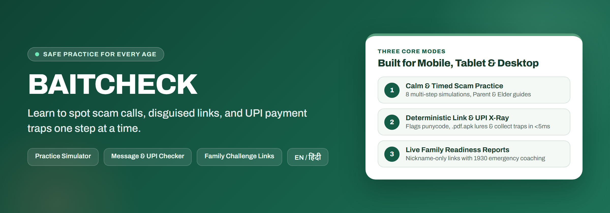
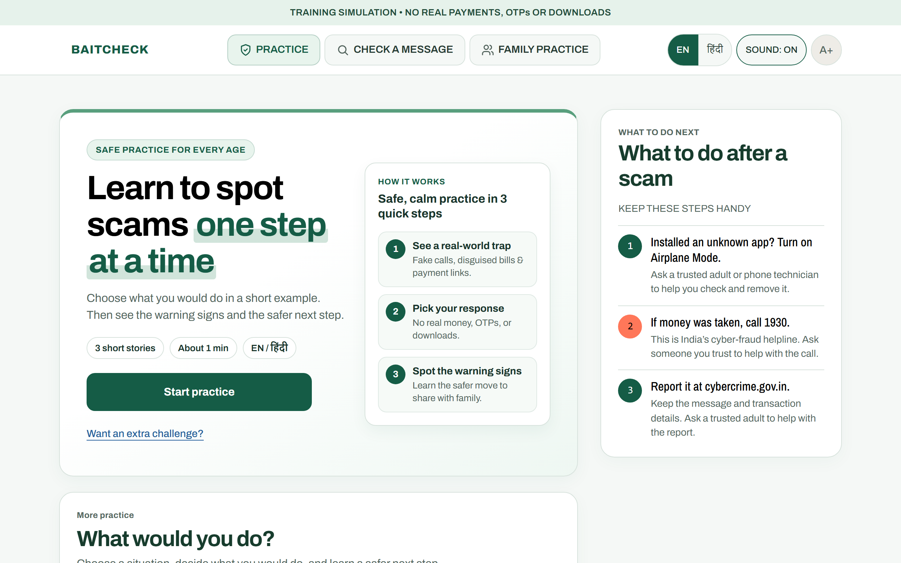
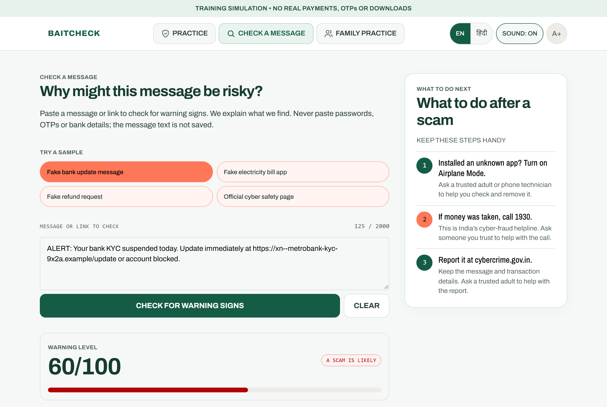
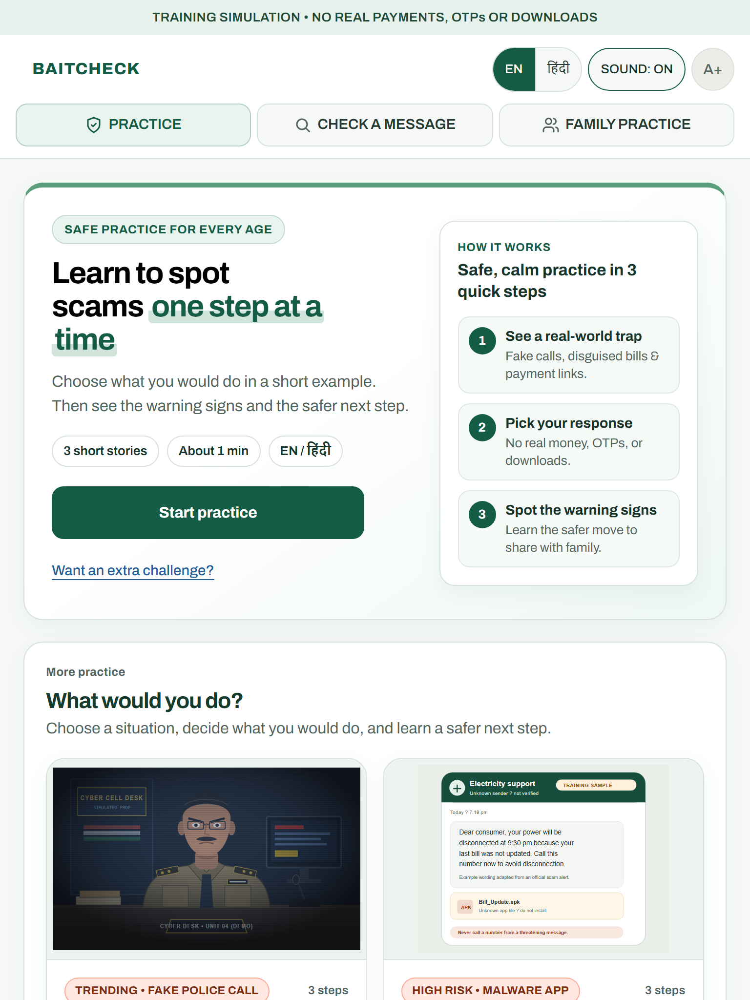
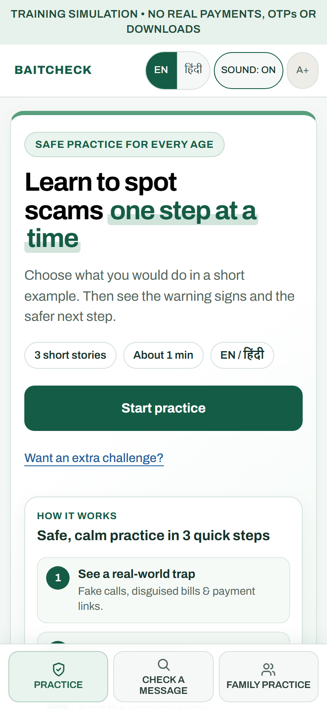
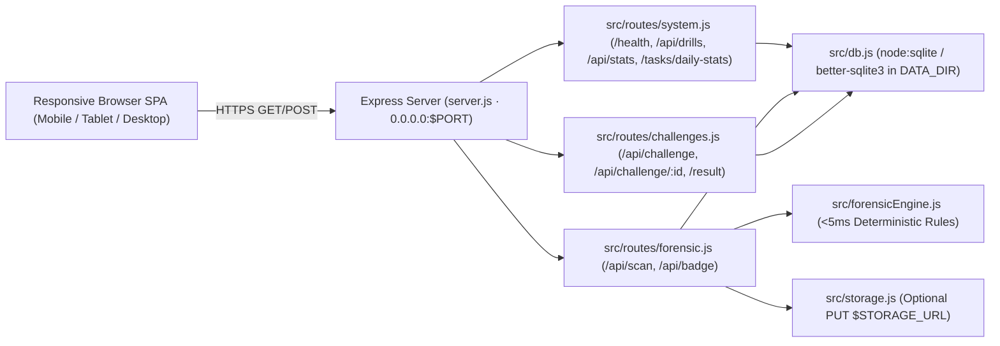

<div align="center">
  

  <br /><br />

  <h1>BAITCHECK</h1>
  <p>
    <strong>Bilingual Scam-Safety Practice App, Real-Life Scam Simulator &amp; Deterministic Message/UPI Checker</strong>
  </p>

  <p>
    <a href="https://baitcheck.embarko.app"></a>
    <a href="https://github.com/SanTiwari07/BaitCheck/actions"></a>
    
    
  </p>

  <p>
    Built for the <strong>Deploy With Embarko Student Challenge 2026</strong> ·
    <a href="https://baitcheck.embarko.app"><strong>Launch Live App</strong></a> ·
    <a href="docs/DEMO_GUIDE.md"><strong>Demo Guide</strong></a> ·
    <a href="docs/reports/TEST_REPORT.md"><strong>Test &amp; Security Report</strong></a>
  </p>
</div>

---

## Overview

Modern scams rarely rely on obvious typos. Instead, they create urgency and social pressure across phone calls, video calls, chat attachments, and payment requests:

1. **Fake Authority & "Digital Arrest" Calls** that demand isolation and instant "refundable security deposits".
2. **Disguised `.pdf.apk` Attachments** (such as fake electricity disconnection notices) designed to steal SMS OTPs.
3. **UPI Cashback / Refund Collect Traps** that exploit confusion around UPI PINs (`a UPI PIN only sends money out, never receives it`).

**BaitCheck** gives families, older adults, and students a calm, no-login browser space to practice spotting scams step by step, inspect suspicious messages and payment links, and share practice links with family members. Everything runs with fictional examples, bilingual **English and Hindi (`EN` / `हिंदी`)** support, an **`A+` large-text toggle**, and responsive layouts for mobile, tablet, and desktop.

---

## Demo Videos & Social Showcase

Watch BaitCheck in action across our walkthrough and scam-awareness shorts:

- **Main Showcase on X:** [x.com/santiwari07/status/2124546849399054362](https://x.com/santiwari07/status/2124546849399054362)
- **YouTube Short:** [youtube.com/shorts/D_qZgbC9ias](https://www.youtube.com/shorts/D_qZgbC9ias)
- **Instagram Reel:** [instagram.com/reels/DgDROwGA6i2/](https://www.instagram.com/reels/DgDROwGA6i2/)

---

## Screenshots

### Desktop Start Page (1280x800)



### Check a Message & Warning Sign Highlighter



### Tablet & Mobile Responsive Views

<table>
  <tr>
    <th width="62%">Tablet (768x1024)</th>
    <th width="38%">Mobile (390x844)</th>
  </tr>
  <tr>
    <td></td>
    <td></td>
  </tr>
</table>

---

## Core Capabilities

| Mode | What It Does | Key Engineering Highlights |
|---|---|---|
| **Practice & Real-Life Simulator** (`/`, `/c/:id`) | Offers calm untimed 3-story practice, an optional 15-second timed round, and 8 multi-step real-life scam simulations with topic filters plus dedicated **Parent & Kid** and **Elder-Safe** guides. | Tap-to-unlock WebAudio cues, conditional `en-IN`/`hi-IN` speech synthesis, mid-drill timer pause/resume on tab switch, simulated loss debriefs, `1080x1350` Canvas Verdict Ticket PNG export, and a sticky `1930` Emergency Guide. |
| **Check a Message (Link & UPI X-Ray)** (`/?tab=xray`, `POST /api/scan`) | Deterministically analyzes pasted SMS text, URLs, `.apk` filenames, or `upi://pay?...` strings in `<5 ms`, with 4 one-tap sample presets. | Detects Punycode (`xn--`), mixed Cyrillic/Greek homoglyphs (without Devanagari false positives), double-extension executables (`.pdf.apk`), `@` URL userinfo masking, raw IPv4 hosts, URL shorteners, disposable TLDs (`.xyz`, `.top`, `.click`), decoded UPI parameters, and bilingual pressure tokens. |
| **Family Practice & Live Report** (`/?tab=challenge`, `/c/:id/report`) | Generates nickname-only shareable practice links (`/c/mom-7x2a`) so family members can complete drills while senders track live readiness scores and coaching tips. | SQLite persistence in `DATA_DIR` preserving Embarko Litestream `_litestream_*` tables, 4-second HTTP polling (no WebSockets), human-readable `missed_flag` coaching, and `localStorage` recent challenge history. |

---

## Architecture Overview



### Safety & Hosting Guardrails

- **Fictional Entities Only:** Uses simulated demo names (`Central Cyber Desk (Simulated)`, `Metro Power Utility (Demo)`, `PaySim Wallet Collect (Demo)`) with zero real bank or government agency impersonation.
- **Permanent Training Banner:** Every route displays a top simulation notice confirming no real payments, OTPs, or file downloads occur.
- **Zero Credential Surfaces:** No password inputs, OTP prompts, card forms, UPI PIN pads, or file downloads.
- **Zero PII Logged:** `forensic_scans` records only `risk_score` and `rules_hit_json`, never raw scanned messages, URLs, or phone numbers.
- **CSP-Safe & Lightweight Runtime:** Zero `innerHTML` usage, zero inline scripts/handlers, zero WebSockets, no `Dockerfile`, running around **~50 MB RSS**.

---

## Project Structure

```text
BaitCheck/
├── .github/workflows/
│   └── ci.yml                       # GitHub Actions CI (Node 20 & 22 syntax, tests & audit)
├── docs/
│   ├── DEMO_GUIDE.md                # Step-by-step live demonstration guide
│   ├── screenshots/                 # Desktop, tablet, mobile & message-check UI screenshots
│   ├── reports/
│   │   ├── ENGINEERING_LOG.md       # Engineering log & technical decisions
│   │   ├── IMPLEMENTATION_ROADMAP.md# Feature roadmap & completion status
│   │   ├── PROJECT_ANALYSIS.md      # Requirements traceability & conflict register
│   │   └── TEST_REPORT.md           # Automated test, security & benchmark report
│   └── specs/                       # Design, PRD, and requirement specifications
├── public/
│   ├── assets/
│   │   ├── sim/                     # Bilingual training videos & SVG/JPG scenario visuals
│   │   ├── favicon.svg              # App icon
│   │   └── social-card.svg          # OpenGraph / social preview banner
│   ├── js/
│   │   ├── views/
│   │   │   ├── challenge.js         # Family Practice link creator & recent history
│   │   │   ├── companion.js         # Emergency 1930 guide & cohort stats panel
│   │   │   ├── drill.js             # Start hero, practice drills, debrief & verdict ticket
│   │   │   ├── report.js            # /c/:id/report live readiness view (4s polling)
│   │   │   ├── simulator.js         # Multi-step scam simulator, Parent/Kid & Elder modes
│   │   │   └── xray.js              # Check a Message workbench & lossless highlighter
│   │   ├── audio.js                 # WebAudio cues & conditional speechSynthesis
│   │   ├── dom.js                   # Safe createElement helpers & SVG builders
│   │   ├── i18n.js                  # EN & हिंदी copy, X-Ray rule localization & flags
│   │   ├── main.js                  # Bootstrap, API sync, top bar & SPA router
│   │   ├── motion.js                # Reduced-motion-safe staggered reveals & transitions
│   │   ├── scenarios.js             # 8 multi-step real-life scam scenarios & parent quizzes
│   │   ├── state.js                 # Centralized app state, route parser & localStorage
│   │   └── ticketCanvas.js          # 1080x1350 Canvas Verdict Ticket PNG generator
│   ├── index.html                   # CSP-clean responsive HTML shell
│   └── styles.css                   # Responsive mobile/tablet/desktop styles & themes
├── src/
│   ├── routes/
│   │   ├── challenges.js            # Challenge creation, report lookup & result ingestion
│   │   ├── forensic.js              # /api/scan and /api/badge upload endpoints
│   │   └── system.js                # /health, /api/drills, /api/stats & cron routes
│   ├── db.js                        # Dual-driver SQLite persistence (DATA_DIR + Litestream safe)
│   ├── drills.js                    # Bilingual drills, 1930 playbook & 4 safe presets
│   ├── forensicEngine.js            # Deterministic O(n) scam & UPI forensic parser
│   └── storage.js                   # Optional Embarko STORAGE_URL PNG badge uploader
├── tests/
│   ├── api.test.js                  # SQLite persistence, zero-PII & REST API integration tests
│   ├── db.test.js                   # DATA_DIR path, IST dates & drill lookup unit tests
│   ├── e2e.test.js                  # Headless Chromium CDP E2E tests (360x800 to 1280x800)
│   ├── forensic.test.js             # Forensic engine & brand-safety unit tests
│   └── storage.test.js              # PNG magic-byte, filename & token-redaction tests
├── embarko.json                     # Embarko appId & daily /tasks/daily-stats cron schedule
├── package.json
├── package-lock.json
└── server.js                        # Express app factory & 0.0.0.0:$PORT entrypoint
```

---

## Getting Started Locally

### Prerequisites

- **Node.js `20+`** (uses built-in `node:sqlite` on Node 22.5+/26+, with `better-sqlite3` in `optionalDependencies` for Node 20).

### Install & Run

```bash
npm install
npm start
```

The server listens on `http://0.0.0.0:3000` (configurable via `PORT`). Open `http://localhost:3000` in your browser.

### Run Complete Verification Suite

```bash
npm test
```

Runs all unit, SQLite persistence, storage, REST API integration, and headless Chromium CDP end-to-end tests (**64/64 passing**).

---

## REST API Reference

| Method & Path | Purpose | Notes |
|---|---|---|
| `GET /health` | Runtime health & memory telemetry | Returns `{ ok: true, memoryMb, uptime }` |
| `GET /api/drills` | Bilingual drills, `1930` playbook & X-Ray presets | Hydrates frontend dynamically |
| `GET /api/stats` | Aggregate practice activity stats | Combines baseline `daily_stats` + live results |
| `POST /api/scan` | Deterministic link/message/UPI forensic analysis | Max `2,000` chars; logs zero PII |
| `POST /api/challenge` | Creates shareable `/c/:id` challenge slug | Nicknames `1-40` chars only (`en` \| `hi`) |
| `GET /api/challenge/:id` | Challenge metadata, drill results & weighted summary | Used by `/c/:id` and 4s polling on `/c/:id/report` |
| `POST /api/challenge/:id/result` | Persists a completed drill (`passed`, `reactionMs`, `missedFlag`) | Strict boolean validation (`400` on invalid input) |
| `POST /api/badge` | Optional `1080x1350` PNG upload to `STORAGE_URL` | Falls back to local download when unset |
| `GET /tasks/daily-stats` | Daily benchmark rollup (`embarko.json` `0 9 * * *` IST) | Validates `Authorization: Bearer $CRON_SECRET` when set |

---

## Documentation & Reports

- **[Operator Demo Guide](docs/DEMO_GUIDE.md)** - Cold-start 60-90s demo flow, environment variables, sample payloads & troubleshooting.
- **[Test & Security Report](docs/reports/TEST_REPORT.md)** - `npm audit`, XSS/CSP/brand-safety checks, memory benchmarks & verbatim test output.
- **[Project Analysis](docs/reports/PROJECT_ANALYSIS.md)** - Requirements traceability matrix & specification conflict register.
- **[Implementation Roadmap](docs/reports/IMPLEMENTATION_ROADMAP.md)** - Feature breakdown and verification status.
- **[Engineering Log](docs/reports/ENGINEERING_LOG.md)** - Architecture decisions, bug discoveries & fixes.
