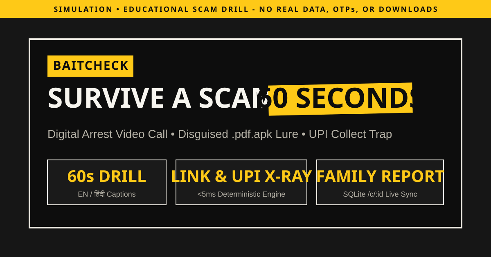
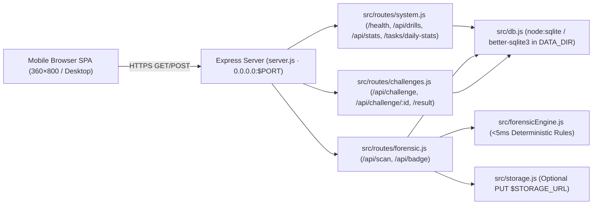

<div align="center">
  

  <br /><br />

  <h1>BAITCHECK</h1>
  <p>
    <strong>60-Second Interactive AI-Era Scam Survival Trainer, Deterministic Forensic Link/UPI X-Ray &amp; Family Readiness Platform</strong>
  </p>

  <p>
    <a href="https://baitcheck.embarko.app"></a>
    <a href="https://github.com/SanTiwari07/BaitCheck/actions"></a>
    
    
  </p>

  <p>
    Built for the <strong>Deploy With Embarko Student Challenge 2026</strong> (<code>#DeployWithEmbarko</code>)
    <a href="https://baitcheck.embarko.app"><strong>Launch Live App</strong></a> ·
    <a href="docs/DEMO_GUIDE.md"><strong>Demo Guide</strong></a> ·
    <a href="docs/reports/TEST_REPORT.md"><strong>Test &amp; Security Report</strong></a>
  </p>
</div>

---

## Why BaitCheck?

Modern scams no longer rely on typos-they hijack **15 seconds of human panic**:
1. **AI Voice / "Digital Arrest" Video Calls** demanding forced isolation and instant "refundable security deposits".
2. **Disguised `.pdf.apk` Chat Lures** (fake electricity cutoff bills or delivery notices) capturing SMS OTPs and Android Accessibility control.
3. **UPI Cashback / Refund Collect Traps** exploiting confusion around UPI PINs (`PIN only sends money out, never receives it`).

Passive awareness posters fail under pressure, caller-ID apps are reactive, and OS-level scam filters are hardware-gated. **BaitCheck** trains real decision reflexes in 60 seconds inside any mobile browser-with zero login walls-paired with a real-time forensic scanner and shareable family readiness links.

---

## Core Capabilities

| Mode | What It Does | Key Engineering Highlights |
|---|---|---|
| **01 · 60s Panic Drill** (`/`, `/c/:id`) | Drops users directly onto a pulsing simulated incoming call (`Central Cyber Desk`), followed by `.pdf.apk` utility lure and UPI collect traps-each on a 15-second clock with `EN \| हिंदी` always-on `>=18px` captions. | Tap-to-unlock WebAudio `AudioContext` cues, conditional `en-IN`/`hi-IN` `speechSynthesis`, mid-drill tab-switch timer pause/resume, `-₹50,000` simulated loss debriefs, `1080×1350` Canvas Verdict Ticket PNG + `1930` Golden-Hour checklist. |
| **02 · Link, Message & UPI X-Ray** (`/?tab=xray`, `POST /api/scan`) | Deterministically dissects arbitrary SMS text, URLs, `.apk` filenames, or `upi://pay?...` strings in `<5 ms` with 4 one-tap real-world presets. | Detects Punycode (`xn--`), mixed Cyrillic/Greek homoglyphs (zero Devanagari false positives), double-extension executables, `@` URL userinfo masking, raw IPv4 hosts, shorteners, disposable TLDs (`.xyz`/`.top`/`.click`), decoded UPI params, and bilingual pressure tokens. |
| **03 · Family Challenge & Live Report** (`/?tab=challenge`, `/c/:id/report`) | Generates nickname-only personal challenge links (`/c/mom-7x2a`) to test parents, siblings, or friends and monitor results live. | SQLite persistence in `DATA_DIR` preserving Embarko Litestream `_litestream_*` tables, 4-second HTTP polling (zero WebSockets), human-readable `missed_flag` diagnostics, and `localStorage` recent challenge history. |

---

## Architecture Overview



### Strict Anti-Phishing & Embarko Hosting Guardrails
- **Zero Real Brand/Agency Impersonation:** Uses fictional demo entities only (`Central Cyber Desk (Simulated)`, `Metro Power Utility (Demo)`, `PaySim Wallet Collect (Demo)`).
- **Permanent Sticky Safety Ribbon:** Top bar across every route reads `SIMULATION • EDUCATIONAL SCAM DRILL - NO REAL DATA, OTPs, OR DOWNLOADS`.
- **Zero Credential / Download Surfaces:** Zero `<input type="password">`, OTP boxes, card forms, UPI PIN keypads, or file downloads.
- **Zero PII Stored:** `forensic_scans` records only `risk_score` and `rules_hit_json` (never raw scanned text or phone numbers).
- **CSP-Safe & Lean Runtime:** Zero `innerHTML`, zero inline `<script>` / `onclick=` handlers, zero WebSockets, no `Dockerfile`, running at **~52–57 MB RSS** inside Embarko's **256 MB** RAM cap.

---

## Project Structure

```text
BaitCheck/
├── .github/workflows/
│   └── ci.yml                       # GitHub Actions CI (Node 20 & 22 syntax, tests & audit)
├── docs/
│   ├── DEMO_GUIDE.md                # Step-by-step live hackathon demonstration guide
│   ├── reports/
│   │   ├── ENGINEERING_LOG.md       # Multi-agent engineering log & decisions
│   │   ├── IMPLEMENTATION_ROADMAP.md# Prioritized feature roadmap & status
│   │   ├── PROJECT_ANALYSIS.md      # Requirements traceability & conflict register
│   │   └── TEST_REPORT.md           # Automated test, security & benchmark report
│   └── specs/
│       ├── BaitCheck_Embarko_Hackathon_Dossier.pdf
│       ├── design.md                # Bill-Poster & Print-Shop Editorial Design System
│       ├── detailed_plan.md         # Execution schedule & API contracts
│       ├── hackathon_requirement.md # Embarko Student Challenge rules & limits
│       ├── prd.md                   # Product Requirements Document
│       └── requirement.md           # Functional, forensic & SQLite specifications
├── public/
│   ├── assets/
│   │   ├── favicon.svg              # Custom Bill-Poster SVG mark
│   │   └── social-card.svg          # OpenGraph / social preview banner
│   ├── js/
│   │   ├── views/
│   │   │   ├── challenge.js         # Tab 3 family challenge creator & recent history
│   │   │   ├── companion.js         # Split-flap community benchmark & 1930 playbook
│   │   │   ├── drill.js             # Screen 0 hero, 3 timed drills, debrief & finale
│   │   │   ├── report.js            # /c/:id/report live readiness sheet (4s polling)
│   │   │   └── xray.js              # Tab 2 forensic workbench & lossless highlighter
│   │   ├── audio.js                 # WebAudio synthesizer & conditional speechSynthesis
│   │   ├── dom.js                   # Safe createElement helpers & geometric SVG builders
│   │   ├── i18n.js                  # EN & हिंदी copy, X-Ray rule localization & flags
│   │   ├── main.js                  # Bootstrap, API sync, top bar & SPA router
│   │   ├── state.js                 # Centralized app state, route parser & localStorage
│   │   └── ticketCanvas.js          # 1080×1350 Canvas Verdict Ticket PNG generator
│   ├── index.html                   # CSP-clean mobile-first HTML shell
│   └── styles.css                   # Bill-Poster editorial design tokens & breakpoints
├── src/
│   ├── routes/
│   │   ├── challenges.js            # Challenge creation, report lookup & result ingestion
│   │   ├── forensic.js              # /api/scan and /api/badge upload endpoints
│   │   └── system.js                # /health, /api/drills, /api/stats & cron routes
│   ├── db.js                        # Dual-driver SQLite persistence (DATA_DIR + Litestream safe)
│   ├── drills.js                    # Bilingual drills, 1930 playbook & 4 safe presets
│   ├── forensicEngine.js            # Deterministic O(n) scam & UPI forensic parser
│   └── storage.js                   # Optional Embarko STORAGE_URL PNG badge uploader
├── tests/
│   ├── api.test.js                  # SQLite persistence, zero-PII & REST API integration tests
│   ├── db.test.js                   # DATA_DIR path, IST dates & drill lookup unit tests
│   ├── e2e.test.js                  # Headless Chrome CDP E2E tests (360×800 to 1280×800)
│   ├── forensic.test.js             # 30+ forensic engine & brand-safety unit tests
│   └── storage.test.js              # PNG magic-byte, filename & token-redaction tests
├── .editorconfig
├── .gitattributes
├── .gitignore
├── embarko.json                     # Embarko appId & daily /tasks/daily-stats cron schedule
├── package.json
├── package-lock.json
└── server.js                        # Express app factory & 0.0.0.0:$PORT entrypoint
```

---

## Getting Started Locally

### Prerequisites
- **Node.js `20+`** (uses built-in `node:sqlite` on Node 22.5+/26+, with `better-sqlite3` in `optionalDependencies` for Node 20).

### Install & Run
```bash
npm install
npm start
```
The server starts on `http://0.0.0.0:3000` (configurable via `PORT`).

### Run Complete Verification Suite
```bash
npm test
```
Executes unit, SQLite persistence, storage, REST API integration, and real headless Chromium CDP end-to-end tests (`60/60` passing).

---

## REST API Reference

| Method & Path | Purpose | Notes |
|---|---|---|
| `GET /health` | Runtime health & memory telemetry | Returns `{ ok: true, memoryMb, uptime }` |
| `GET /api/drills` | Bilingual drills, `1930` playbook & X-Ray presets | Hydrates frontend dynamically |
| `GET /api/stats` | Community benchmark split-flap stats | Aggregates baseline `daily_stats` + live results |
| `POST /api/scan` | Deterministic link/message/UPI forensic analysis | Max `2,000` chars; logs zero PII |
| `POST /api/challenge` | Creates shareable `/c/:id` challenge slug | Nicknames `1–40` chars only (`en` \| `hi`) |
| `GET /api/challenge/:id` | Challenge metadata, drill results & weighted summary | Used by `/c/:id` and 4s polling on `/c/:id/report` |
| `POST /api/challenge/:id/result` | Persists a completed drill (`passed`, `reactionMs`, `missedFlag`) | Strict boolean validation (`400` on invalid input) |
| `POST /api/badge` | Optional `1080×1350` PNG upload to `STORAGE_URL` | Gracefully falls back to local download when unset |
| `GET /tasks/daily-stats` | Daily benchmark rollup (`embarko.json` `0 9 * * *` IST) | Validates `Authorization: Bearer $CRON_SECRET` when set |

---

## Documentation & Reports

- **[Operator Demo Guide](docs/DEMO_GUIDE.md)** - Cold-start 60–90s demo flow, environment variables, sample payloads & troubleshooting.
- **[Test & Security Report](docs/reports/TEST_REPORT.md)** - `npm audit`, XSS/CSP/brand-safety checks, memory benchmarks & verbatim test output.
- **[Project Analysis](docs/reports/PROJECT_ANALYSIS.md)** - Complete requirements traceability matrix & specification conflict register.
- **[Implementation Roadmap](docs/reports/IMPLEMENTATION_ROADMAP.md)** - Prioritized feature breakdown and verification status.
- **[Engineering Log](docs/reports/ENGINEERING_LOG.md)** - Multi-agent architecture decisions, bug discoveries & fixes.
